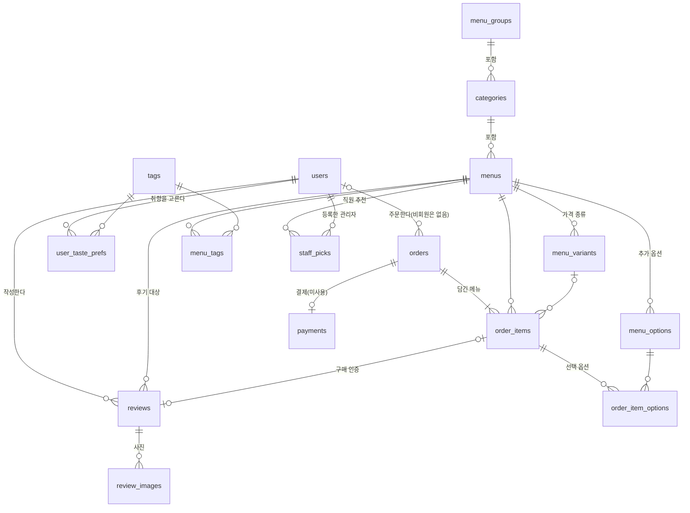

# 원보틀 카페 사이트 DB 설계안 (v1)

추가할 기능: **로그인 · 메뉴 추천 · 후기 · 메뉴 주문**
기준 데이터: `js/menu-data.js` (GROUPS → CATEGORIES → items)

> 아직 구현 전 설계안입니다. SQL은 PostgreSQL 기준이지만 MySQL로 옮겨도 구조는 같습니다.

---

## 1. 한눈에 보기 (ERD)

테이블은 기능별로 4묶음, 총 16개입니다.

| 기능 | 테이블 |
|---|---|
| 로그인 | `users` |
| 메뉴 (기존 데이터 이전) | `menu_groups`, `categories`, `menus`, `menu_variants`, `menu_options` |
| 메뉴 추천 | `tags`, `menu_tags`, `user_taste_prefs`, `staff_picks` |
| 주문 | `orders`, `order_items`, `order_item_options`, `payments` |
| 후기 | `reviews`, `review_images` |

---

## 2. 메뉴 (menu-data.js → DB)

### menu-data.js와의 대응

| menu-data.js | DB |
|---|---|
| `GROUPS[]` (`drinks`, `dessert`) | `menu_groups` |
| `CATEGORIES[]` (`coffee`, `latte` …) | `categories` |
| `items[]` | `menus` |
| `price: 4.5` (1,000원 단위) | `menus.price = 4500` (**원 단위 정수**로 저장, 소수점 오차 방지) |
| `temp` 없음 → 카테고리 값 따름 | `menus.temp = NULL` → `categories.default_temp` 사용 |
| `temp: null` (표시 안 함) | `menus.temp = 'none'` (NULL과 구분해야 해서 값을 따로 둠) |
| `caffeine` / `milk` | `menus.has_caffeine` / `menus.has_milk` |
| `options: [{label, price}]` | `menu_options` |
| `variants: [{label, price}]` (어린이 음료) | `menu_variants`, 이때 `menus.price = NULL` |
| `note: '2인 기준 · 여름 한정'` | `categories.note` |

### menu_groups
| 컬럼 | 타입 | 설명 |
|---|---|---|
| id | VARCHAR(20) PK | `drinks`, `dessert` |
| name_en | VARCHAR(30) | `DRINKS` |
| name_ko | VARCHAR(30) | `음료` |
| sort_order | INT | 표시 순서 |

### categories
| 컬럼 | 타입 | 설명 |
|---|---|---|
| id | VARCHAR(20) PK | `coffee`, `latte`, `tea`, `ade` … |
| group_id | FK → menu_groups.id | |
| name_en / name_ko | VARCHAR(30) | `COFFEE` / `커피` |
| default_temp | ENUM('both','ice','hot','none') | 카테고리 기본 온도 |
| default_caffeine | BOOLEAN NULL | NULL이면 표시 안 함 |
| note | VARCHAR(100) NULL | `2인 기준 · 여름 한정` |
| sort_order | INT | |

### menus
| 컬럼 | 타입 | 설명 |
|---|---|---|
| id | SERIAL PK | |
| category_id | FK → categories.id | |
| name | VARCHAR(50) | `아메리카노` |
| description | TEXT | `desc` |
| price | INT NULL | 원 단위. variants가 있으면 NULL |
| temp | ENUM('both','ice','hot','none') NULL | NULL = 카테고리 값 따름 |
| has_caffeine | BOOLEAN NULL | NULL = 카테고리 값 따름 |
| has_milk | BOOLEAN | 기본 false |
| image_url | VARCHAR(255) NULL | 나중에 메뉴 사진용 |
| is_available | BOOLEAN | 품절/판매중지 (기본 true) |
| sort_order | INT | |
| created_at / updated_at | TIMESTAMP | |

### menu_variants (가격이 여러 개인 메뉴)
| 컬럼 | 타입 | 설명 |
|---|---|---|
| id | SERIAL PK | |
| menu_id | FK → menus.id | |
| label | VARCHAR(30) | `뽀로로 음료` |
| price | INT | 3500 |
| sort_order | INT | |

### menu_options (추가 옵션)
| 컬럼 | 타입 | 설명 |
|---|---|---|
| id | SERIAL PK | |
| menu_id | FK → menus.id | |
| label | VARCHAR(30) | `샷 추가` |
| extra_price | INT | 1000 |

> 참고: 지금은 옵션이 아메리카노에만 있어서 메뉴별로 붙였습니다. 나중에 "샷 추가"를 여러 메뉴에 공통으로 쓰게 되면 `options` + `menu_option_links`(다대다)로 쪼개면 됩니다.

---

## 3. 로그인

### users (회원 프로필)
이메일·비밀번호·카카오 로그인은 **Supabase Auth**(`auth.users`)가 관리합니다. 비밀번호도 Supabase가 안전하게 해시해서 보관하므로 이 테이블에는 없습니다. `users`는 닉네임·전화번호·권한 같은 추가 정보만 가집니다.

| 컬럼 | 타입 | 설명 |
|---|---|---|
| id | UUID PK, FK → auth.users.id | Supabase 로그인 계정과 같은 id |
| email | VARCHAR(100) | 표시용 복사본 |
| nickname | VARCHAR(30) | 후기에 표시될 이름 |
| phone | VARCHAR(20) NOT NULL | **회원가입 시 필수**. 로그인 상태로 주문하면 이 번호가 주문 전화번호에 자동으로 채워짐 (숫자만 저장) |
| role | ENUM('customer','admin') | 손님 / 관리자(사장님: 메뉴·주문·직원 추천 메뉴 관리) |
| created_at | TIMESTAMPTZ | |
| deleted_at | TIMESTAMPTZ NULL | 탈퇴 처리 (주문·후기 기록 보존용) |

- 회원가입하면 트리거(`handle_new_user`)가 `users` 행을 자동으로 만듭니다. 가입할 때 `options.data`에 `nickname`, `phone`을 같이 보내면 됩니다.
- 관리자 지정: 가입 후 SQL Editor에서 `UPDATE users SET role = 'admin' WHERE email = '관리자이메일';`
- 손님은 본인 닉네임·전화번호만 수정할 수 있고, `role`은 못 바꿉니다.

---

## 4. 메뉴 추천

추천은 4가지 재료로 만들 수 있게 설계했습니다.
1. **취향 태그 매칭**: 사용자가 고른 취향(달콤, 상큼, 고소, 논카페인 …)과 메뉴 태그가 겹치는 메뉴
2. **인기 메뉴**: `order_items` 집계 (따로 테이블 필요 없음)
3. **평점 높은 메뉴**: `reviews.rating` 평균 (따로 테이블 필요 없음)
4. **직원 추천 메뉴**: 직원이 직접 고른 메뉴 목록 + 추천 한마디 (`staff_picks`)

### tags
| 컬럼 | 타입 | 설명 |
|---|---|---|
| id | SERIAL PK | |
| name | VARCHAR(20) UNIQUE | `달콤한`, `상큼한`, `고소한`, `쌉싸름한`, `시원한`, `든든한` |
| type | ENUM('taste','mood','etc') | 분류 (선택) |

### menu_tags (메뉴 ↔ 태그, 다대다)
| 컬럼 | 타입 |
|---|---|
| menu_id | FK → menus.id |
| tag_id | FK → tags.id |
| PK(menu_id, tag_id) | |

### user_taste_prefs (사용자 ↔ 취향 태그, 다대다)
| 컬럼 | 타입 |
|---|---|
| user_id | FK → users.id |
| tag_id | FK → tags.id |
| PK(user_id, tag_id) | |

### staff_picks (직원 추천 메뉴)
| 컬럼 | 타입 | 설명 |
|---|---|---|
| id | SERIAL PK | |
| menu_id | FK → menus.id | 추천하는 메뉴 |
| created_by | FK → users.id NULL | 등록한 관리자 계정 (직원 계정은 따로 없고 관리자가 대신 등록) |
| staff_name | VARCHAR(30) | 화면에 보여줄 추천 직원 이름 `바리스타 민지` (그냥 글자로 입력) |
| comment | VARCHAR(200) | 추천 한마디 `오늘 같은 날엔 따뜻한 흑당라떼!` |
| sort_order | INT | 목록 표시 순서 |
| is_active | BOOLEAN | 노출 여부 (내릴 때 삭제 대신 false) |
| start_date / end_date | DATE NULL | 노출 기간 (비우면 계속 노출). 시즌 추천용 |
| created_at | TIMESTAMP | |

- 같은 메뉴를 여러 직원이 각자 추천할 수 있게 UNIQUE를 걸지 않았습니다.
- 화면에서는 `is_active = true`이고 오늘 날짜가 기간 안에 있는 것만 `sort_order` 순으로 보여주면 됩니다.

> 카페인/우유 여부는 이미 `menus`에 있으니 "논카페인만", "우유 없는 메뉴만" 같은 필터는 태그 없이 바로 됩니다.
> 로그인 안 한 사람용 추천(간단한 질문 → 추천)은 DB 저장 없이 화면에서 태그만 골라 조회하면 됩니다.

---

## 5. 메뉴 주문

### orders
| 컬럼 | 타입 | 설명 |
|---|---|---|
| id | SERIAL PK | |
| order_no | SMALLINT | 손님에게 보여줄 주문번호. **1~100** 순환, 화면에는 3자리로 `001`, `047`, `100` |
| order_date | DATE | 주문 날짜 (번호를 하루 단위로 새로 시작하기 위함) |
| user_id | FK → users.id **NULL** | 회원 주문이면 회원 id, **비회원 주문이면 NULL** |
| status | ENUM('pending','paid','preparing','ready','completed','canceled') | 주문 상태 |
| order_type | ENUM('dine_in','takeout') | 매장 / 포장 |
| total_price | INT | 원 단위 합계 |
| contact_phone | VARCHAR(20) | **주문자 전화번호 (필수, 회원·비회원 모두)**. 비회원은 이 번호만 입력. 회원은 `users.phone`을 미리 채워 주고 수정 가능. 음료가 나오면 이 번호로 호출 |
| request_note | VARCHAR(200) NULL | 요청사항 |
| pickup_time | TIMESTAMP NULL | 픽업 예정 시간 (선택) |
| created_at / updated_at | TIMESTAMP | |

### order_items
| 컬럼 | 타입 | 설명 |
|---|---|---|
| id | SERIAL PK | |
| order_id | FK → orders.id | |
| menu_id | FK → menus.id | |
| variant_id | FK → menu_variants.id NULL | 어린이 음료처럼 종류 고른 경우 |
| menu_name | VARCHAR(50) | **주문 당시 이름 복사본** |
| unit_price | INT | **주문 당시 가격 복사본** (옵션 제외) |
| temp | ENUM('hot','ice') NULL | 손님이 고른 온도 |
| quantity | INT | 1 이상 |
| line_total | INT | (unit_price + 옵션 합) × quantity |

### order_item_options
| 컬럼 | 타입 | 설명 |
|---|---|---|
| id | SERIAL PK | |
| order_item_id | FK → order_items.id | |
| option_id | FK → menu_options.id | |
| label | VARCHAR(30) | 주문 당시 옵션명 복사본 |
| extra_price | INT | 주문 당시 옵션 가격 복사본 |

> **주문번호 규칙:** 매일 `001`부터 시작하고, `100` 다음은 다시 `001`로 돌아갑니다. 번호가 반복되므로 주문을 구분하는 진짜 키는 `id`이고, `order_no`는 손님 호출용 번호입니다. 같은 번호가 동시에 두 개 쓰이지 않도록 **진행 중인 주문끼리만** 중복을 막습니다(아래 SQL의 부분 인덱스). 화면 표시는 `String(order_no).padStart(3, '0')`.
>
> 다음 번호 구하기: 오늘 가장 최근 주문번호가 `n`이면 다음은 `n % 100 + 1`, 오늘 첫 주문이면 `1`.

> **비회원 주문:** 로그인 없이 전화번호만 입력하면 주문할 수 있습니다(`user_id = NULL`). 비회원이 주문 내역을 확인할 때는 **전화번호 + 주문번호**로 조회합니다. 후기는 회원만 쓸 수 있으므로 비회원 주문에는 후기가 연결되지 않습니다.

> **전화번호도 주문에 따로 저장하는 이유:** 회원이 나중에 번호를 바꿔도, 그 주문 때 연락받을 번호가 그대로 남아야 하기 때문입니다. 숫자만 저장(`01012345678`)하고 하이픈은 화면에서 붙이는 걸 추천합니다.

> **왜 이름·가격을 복사해 두나요?** 나중에 아메리카노 가격이 5,500원 → 6,000원으로 바뀌어도, 예전 주문 내역은 5,500원으로 남아 있어야 하기 때문입니다.

### payments (테이블만 생성, 현재 미사용)
| 컬럼 | 타입 | 설명 |
|---|---|---|
| id | SERIAL PK | |
| order_id | FK → orders.id UNIQUE | |
| provider | VARCHAR(20) | `toss`, `kakaopay` 등 |
| provider_tx_id | VARCHAR(100) | PG사 거래 번호 |
| amount | INT | |
| status | ENUM('ready','approved','canceled','failed') | |
| approved_at | TIMESTAMP NULL | |

> **현재는 테이블만 만들어 두고 쓰지 않습니다.** 나중에 온라인 결제(PG)를 붙일 때 이 테이블에 기록합니다. 지금은 결제를 매장에서 하므로 주문 흐름은 `pending`(접수) → `preparing`(제조 중) → `ready`(픽업 대기) → `completed`(완료)이고, `paid` 상태는 결제 연동 전까지 쓰지 않습니다. 장바구니는 로그인 전에도 써야 해서 DB 대신 브라우저(localStorage)에 두는 걸 추천합니다.

---

## 6. 후기

### reviews
| 컬럼 | 타입 | 설명 |
|---|---|---|
| id | SERIAL PK | |
| user_id | FK → users.id | |
| menu_id | FK → menus.id | 어떤 메뉴에 대한 후기인지 |
| order_item_id | FK → order_items.id NULL, UNIQUE | 구매 인증. 주문 한 건당 후기 1개 |
| rating | SMALLINT | 1~5 (CHECK) |
| content | TEXT | |
| is_hidden | BOOLEAN | 관리자 숨김 처리 |
| created_at / updated_at | TIMESTAMP | |

### review_images
| 컬럼 | 타입 | 설명 |
|---|---|---|
| id | SERIAL PK | |
| review_id | FK → reviews.id (삭제 시 같이 삭제) | |
| image_url | VARCHAR(255) | 이미지 파일은 스토리지에, DB엔 주소만 |
| sort_order | INT | |

> 카페 전체 후기(메뉴와 상관없는 매장 후기)도 받고 싶으면 `menu_id`를 NULL 허용으로 바꾸면 됩니다.

---

## 7. SQL과 보안 규칙

실제 SQL은 **`db/schema.sql`** 한 파일에 있습니다 (테이블 + 주문 함수 + 보안 규칙). 메뉴 데이터는 `db/seed.sql`.

### 주문은 함수로만
손님은 `orders`에 직접 넣지 못하고 `place_order()` 함수를 호출합니다. 함수가 하는 일:
- 전화번호 형식 확인 (숫자만 남겨서 `01X` + 8~9자리)
- 메뉴 가격·옵션 가격을 **DB에서 다시 계산** (화면에서 가격을 조작해도 소용없음)
- HOT/ICE 선택 확인, 그 메뉴의 옵션인지 확인
- 주문번호 `001~100` 발급 (한국 날짜 기준 매일 초기화, 동시 주문에도 겹치지 않게 잠금)
- 하나라도 잘못되면 주문 전체 취소

비회원 주문 조회는 `get_order_status(전화번호, 주문번호)` 함수로 오늘 주문만 확인합니다.

### 보안 규칙 (RLS) 요약
| 테이블 | 비회원 | 회원 | 관리자 |
|---|---|---|---|
| 메뉴·카테고리·옵션·태그·직원 추천 | 읽기 | 읽기 | 읽기·수정 |
| users | ✕ | 내 정보 읽기, 닉네임·전화번호 수정 | 전체 읽기 |
| orders / order_items | 함수로 주문만 | 함수로 주문, 내 주문 읽기 | 전체 읽기, 상태 변경 |
| reviews | 읽기 | 읽기, 내 주문 메뉴에 쓰기, 내 후기 수정·삭제 | 전체 관리 (숨김 처리) |
| payments | ✕ | ✕ | 읽기 |

> 날짜 주의: Supabase 서버 시간은 UTC라서 `CURRENT_DATE`를 그대로 쓰면 오전 9시에 날짜가 바뀝니다. 그래서 주문 날짜는 `now() AT TIME ZONE 'Asia/Seoul'`로 한국 날짜를 씁니다.

## 8. 결정된 것
- DB: **Supabase** (PostgreSQL + 로그인), 사이트 배포는 Firebase Hosting 그대로
- 회원 등급: 손님 / 관리자
- 비회원 주문 가능 (전화번호 필수), 주문번호 001~100
- 결제(payments): 테이블만 생성, 현재 미사용
