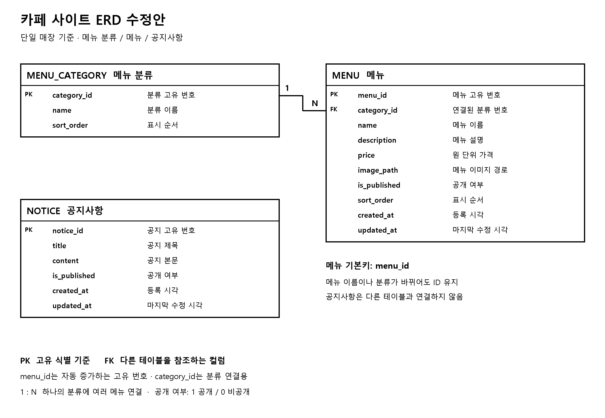

# 원보틀 카페 확정 DB 설계

2026-11-02 확정된 AGENTS.md 기준. schema.sql은 아래 구조를 표현한 MySQL 8.0.16 이상용 SQL이며 실행하지 않았다.

## MENU_CATEGORY — 메뉴 분류

| 컬럼 | 타입 | 조건 및 의미 |
| --- | --- | --- |
| category_id | BIGINT UNSIGNED | PK, 자동 증가 |
| name | VARCHAR(50) | 필수, 분류명 |
| sort_order | INT UNSIGNED | 필수, 기본 0, 표시 순서 |

## MENU — 메뉴

| 컬럼 | 타입 | 조건 및 의미 |
| --- | --- | --- |
| menu_id | BIGINT UNSIGNED | PK, 자동 증가 |
| category_id | BIGINT UNSIGNED | 필수 FK → MENU_CATEGORY.category_id |
| name | VARCHAR(100) | 필수, 메뉴명 |
| description | TEXT | 선택, 메뉴 설명 |
| price | DECIMAL(10, 0) | 필수, 0 이상의 원 단위 가격 |
| image_path | VARCHAR(500) | 선택, 이미지 경로 |
| is_published | BOOLEAN | 필수, 기본 FALSE, 0 또는 1 |
| sort_order | INT UNSIGNED | 필수, 기본 0, 표시 순서 |
| created_at | DATETIME | 필수, 생성 시 현재 시각 |
| updated_at | DATETIME | 필수, 생성 및 수정 시 현재 시각 |

## NOTICE — 공지사항

| 컬럼 | 타입 | 조건 및 의미 |
| --- | --- | --- |
| notice_id | BIGINT UNSIGNED | PK, 자동 증가 |
| title | VARCHAR(200) | 필수, 제목 |
| content | TEXT | 필수, 본문 |
| is_published | BOOLEAN | 필수, 기본 FALSE, 0 또는 1 |
| created_at | DATETIME | 필수, 생성 시 현재 시각 |
| updated_at | DATETIME | 필수, 생성 및 수정 시 현재 시각 |

## 관계 및 조회 규칙

- MENU_CATEGORY 1 : N MENU. 메뉴는 반드시 하나의 분류에 속한다.
- 참조 중인 분류의 삭제 및 기본키 변경은 RESTRICT로 제한한다.
- NOTICE는 독립 테이블이다.
- 방문자 메뉴 및 공지 조회는 is_published = TRUE 조건을 적용한다.
- 메뉴는 분류 sort_order, category_id, 메뉴 sort_order, menu_id 오름차순으로 정렬한다.
- 공지는 created_at 내림차순, 동일 시각이면 notice_id 내림차순으로 정렬한다.
- 전체 메뉴의 '전체'는 화면 필터이며 DB 분류로 저장하지 않는다.
- 매장·회원·문의·관리자 계정 테이블 및 cafe_id는 사용하지 않는다.
- 매장 소개·주소·영업 정보·슬라이드는 페이지 또는 설정 파일에서 관리한다.
- 관리자 기능과 DB 적용은 별도 요청 전까지 진행하지 않는다.

SQL: [schema.sql](schema.sql)
