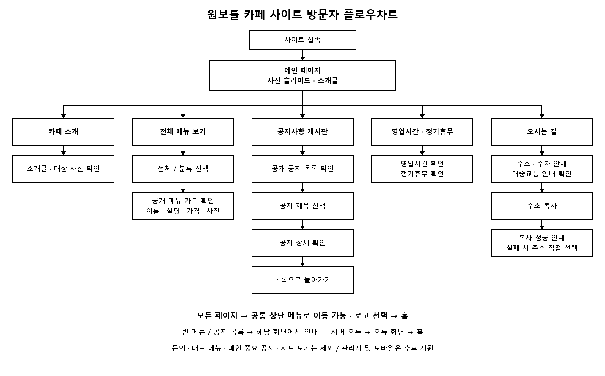
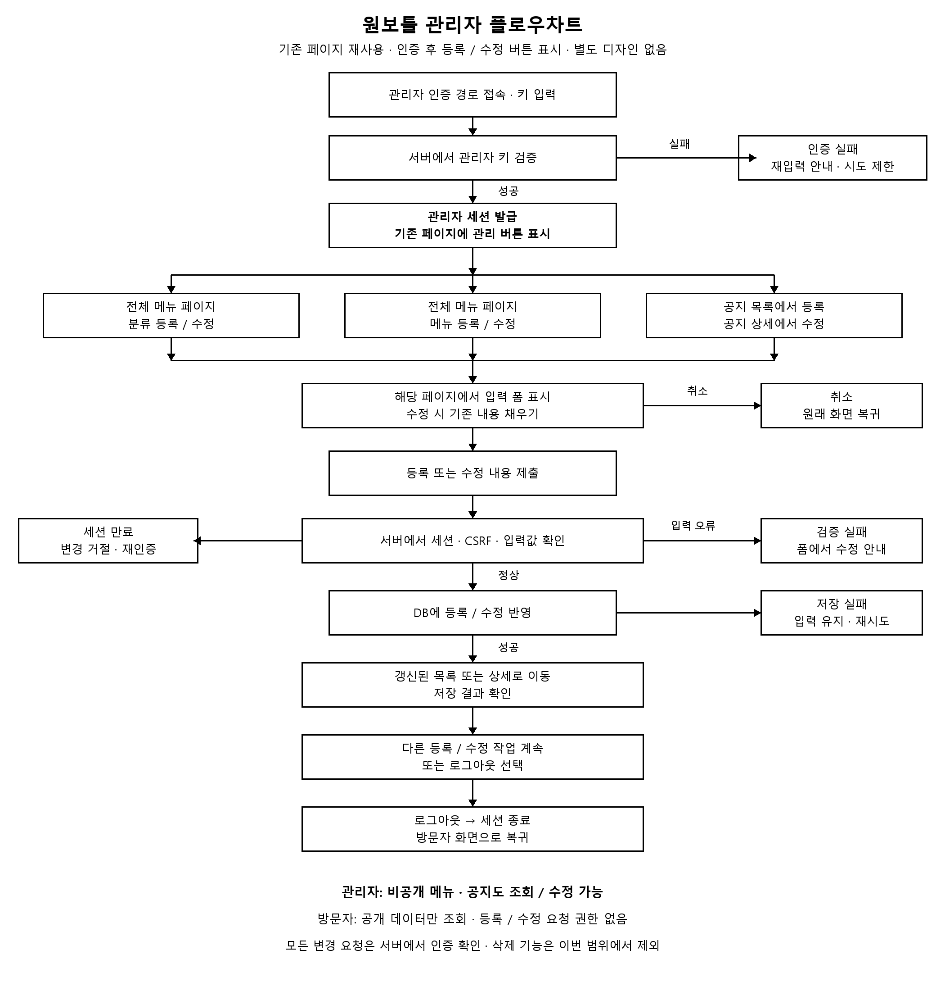

# 원보틀 카페 사이트 요구사항

작성일: 2026-11-02

## 목적과 개발 범위

단일 매장 원보틀의 분위기, 메뉴, 영업 정보, 방문 방법 및 공지사항을 안내하는 PC 우선 웹사이트를 개발한다. HTML·CSS·JavaScript로 화면을 구성하고 JSP 기반 서버와 MySQL을 사용한다. 디자인은 `design.md`, 확정 DB 및 프로젝트 결정은 `AGENTS.md`를 따른다.

이번 범위는 홈, 카페 소개, 전체 메뉴, 공지 목록·상세, 홈 안의 영업 안내 및 오시는 길이다. 방문자 화면은 조회 기능만 제공한다.

모바일 대응 및 관리자 인증·관리 화면은 추후 추가한다. 회원가입, 문의, 주문·결제, 메뉴 상세, 대표 메뉴, 메인 중요 공지, 지도 삽입 및 외부 지도 보기 버튼은 현재 범위에서 제외한다. 네이버 지도 API에 대한 질문만으로 지도 도입이 확정된 것은 아니다.

## 페이지별 기능 및 완료 기준

| 번호 | 화면 또는 기능 | 동작 | 완료 기준 |
| --- | --- | --- | --- |
| R-01 | 공통 상단 메뉴 | 홈·카페 소개·전체 메뉴·공지사항·오시는 길로 이동 | 각 링크가 목적 화면으로 연결되고 로고는 홈으로 이동 |
| R-02 | 메인 사진 슬라이드 | 사진 전환, 이전·다음, 재생·정지 | 사진 개수에 따라 동작하며 사진이 없어도 레이아웃 유지 |
| R-03 | 메인 소개 | 사용자가 작성한 소개글 표시 | 원문을 유지하고 사진 위에서 읽을 수 있음 |
| R-04 | 전체 메뉴 바로가기 | 메인에서 전체 메뉴 페이지로 바로 이동 | 대표 메뉴 확인 단계가 없음 |
| R-05 | 영업 안내 | 홈에서 영업시간과 정기휴무 확인 | 제공된 실제 정보만 표시 |
| R-06 | 카페 소개 | 소개글 및 실제 매장 사진 표시 | 자료가 없는 사진은 대체 영역으로 처리 |
| R-07 | 메뉴 목록 | 전체 또는 선택한 분류의 공개 메뉴를 큰 카드로 표시 | 이름·설명·가격·사진 표시, 비공개 메뉴 제외 |
| R-08 | 분류 선택 | 전체가 기본이며 DB 분류로 필터링 | 선택 상태 표시, 전체는 DB에 별도 저장하지 않음 |
| R-09 | 공지 목록 | 공개된 공지의 제목·번호·등록일 표시 | 최신 등록일 순, 동일 시각은 ID 내림차순 |
| R-10 | 공지 상세 | 제목 선택 후 공개 공지 본문 조회 | 목록으로 복귀 가능, 비공개·없는 공지 내용은 노출하지 않음 |
| R-11 | 오시는 길 | 홈의 주소·주차·대중교통 안내 섹션으로 이동 | 다른 페이지에서도 홈 해당 위치로 이동 |
| R-12 | 주소 복사 | 매장 주소를 클립보드로 복사 | 성공 또는 실패 안내, 실패 시 수동 선택 가능 |
| R-13 | 공통 하단 | 매장명·주소 표시 | 전화·SNS 등은 실제 정보가 제공된 경우에만 추가 |
| R-14 | 빈 목록 및 오류 | 정상적인 빈 데이터는 화면 안에서 안내, 서버 오류는 별도 화면 | 홈으로 복귀 가능하고 내부 오류 정보가 노출되지 않음 |

## 방문자 플로우차트

### 흐름 해설

1. 사이트 접속 후 메인에서 사진 슬라이드와 소개글을 확인한다.
2. 상단 메뉴 또는 메인 바로가기로 전체 메뉴를 열고 전체·분류별 메뉴를 확인한다. 메뉴 상세나 주문 단계는 없다.
3. 카페 소개에서는 소개글과 매장 사진을 확인한다.
4. 공지사항에서는 공개 공지 목록을 확인하고 제목을 선택해 상세를 읽은 뒤 목록으로 돌아간다.
5. 영업시간·정기휴무와 오시는 길은 메인 섹션에서 확인한다. 오시는 길에서는 주소 복사가 가능하며 지도 이동 단계는 없다.
6. 모든 페이지에서 공통 상단 메뉴로 이동할 수 있다. 서버 오류는 오류 화면에서 홈으로 복귀한다.

## 데이터와 운영

### 관리자 이용 흐름

- 관리자 기능은 추후 구현한다. 이번 확정은 화면 방식과 흐름에 대한 설계이며 구현이나 DB 실행 요청은 아니다.
- 기존 페이지의 디자인을 재사용하고 인증 후에만 관리 버튼을 표시한다. 별도 대시보드를 만들지 않는다.
- 별도 인증 경로에서 관리자 키를 입력하고 서버 검증에 성공하면 관리자 세션을 발급한다. 인증 실패는 재입력 안내 및 시도 제한으로 처리한다.
- 전체 메뉴 페이지에서 분류 등록·수정, 메뉴 등록·수정을 제공한다. 공지 목록에서 등록, 공지 상세에서 수정을 제공한다.
- 관리자는 비공개 메뉴와 공지도 조회·수정할 수 있다. 방문자 조회에는 기존 공개 조건을 유지한다.
- 버튼 선택 후 해당 페이지 내 입력 폼을 열고 기존 데이터는 수정 폼에 채운다. 취소하면 DB 변경 없이 원래 화면으로 돌아간다.
- 제출 시마다 서버에서 관리자 세션, CSRF 토큰, 입력값을 검증한 후 저장한다. 메뉴는 존재하는 분류, 0 이상의 가격 등 확정 데이터 규칙을 적용한다.
- 검증 오류는 폼에서 안내하고, 저장 실패는 입력을 유지한 채 재시도를 안내한다. 성공하면 갱신된 목록 또는 상세로 리다이렉트해 새로고침에 의한 중복 제출을 방지한다.
- 세션 만료 시 변경을 거절하고 재인증을 안내한다. 로그아웃 시 세션을 종료하고 관리 버튼과 비공개 데이터가 없는 방문자 화면으로 복귀한다.
- 삭제 기능, 관리자 계정 테이블, 별도 디자인은 이번 설계에 추가하지 않는다.

- 확정 테이블은 MENU_CATEGORY, MENU, NOTICE 총 세 개다.
- 메뉴는 menu_id 기본키로 식별하고 category_id로 분류에 연결한다. 공지는 독립적이다.
- 매장 소개·주소·영업 정보·슬라이드는 페이지 또는 설정 파일에서 관리한다.
- 메뉴는 분류 표시 순서, 메뉴 표시 순서, 메뉴 ID 순으로 정렬한다.
- 비공개 공지 및 메뉴는 서버 조회 단계에서 제외한다. 방문자가 등록·수정·삭제할 수 있는 경로를 만들지 않는다.
- 관리자 기능 추가 전 메뉴·공지 데이터는 개발자 또는 운영 담당자가 DB 도구로 관리하는 것을 기본안으로 한다.
- 관리자 모드는 나중에 서버에서 키 검증 후 세션을 발급하는 방식으로 추가한다. 이번 단계에서는 구현하지 않는다.
- 기존 `docs/database/ERD.md`와 `schema.sql`은 이전 초안이다. 실제 SQL 작성·적용 요청 시 최신 확정 구조로 갱신해야 한다. 이 문서는 DB 생성이나 실행 요청이 아니다.

## 확정된 콘텐츠

- 매장명: 원보틀.
- 주소: 경기 안양시 만안구 예술공원로 238.
- 소개글: `design.md`에 기록한 사용자 원문을 사용한다.
- 디자인: 모던, 사진 슬라이드, 큰 메뉴 카드, PC 우선. 우드 포인트 색상은 #B19376.

## 사용자가 추후 제공할 자료

새 기획 문서를 추가로 작성할 필요는 없다. 사용자는 실제 메뉴명·가격·사진·로고 등을 추후 제공하며, 현재는 개발용 더미를 넣어 개발하기로 확정했다. 메뉴 분류와 공지도 샘플로 화면을 확인할 수 있게 구성한다. 더미임을 명확히 표시하고 자료와 이미지 경로를 교체하기 쉽게 관리한다. 기존에 제공된 매장명·주소·소개글은 유지한다. 실제 자료를 받기 전까지 개발을 중단하지 않는다.

| 자료 | 필요한 내용 | 제공 전 처리 |
| --- | --- | --- |
| 메뉴 자료 | 분류 및 순서, 메뉴명·가격·설명·사진 | 개발용 더미 분류·메뉴명·가격·설명과 대체 이미지 사용 |
| 사진 | 슬라이드·매장 사진과 순서 | 슬라이드와 카드에 개발용 대체 이미지 사용 |
| 영업 정보 | 영업시간, 정기휴무 | 준비 중 안내 |
| 방문 안내 | 주차·대중교통 안내 | 준비 중 안내 |
| 로고 | 실제 로고 파일 | 개발용 텍스트 로고 사용 |
| 공지 | 최초 공개할 제목과 본문 | 개발용 샘플 공지 사용 |
| 선택 연락 정보 | 표시할 전화번호·SNS 주소 | 미표시 |

소개글의 운영 기간과 주소가 현재도 맞는지 공개 전에 확인한다. 배포 서비스와 도메인은 공개 단계에서 정하며 지금 화면 개발을 막는 미정 사항은 아니다. DB 접속 비밀번호·관리자 키는 이 문서에 기록하지 않는다.

## 최종 검수

- 상단 메뉴와 모든 페이지 이동이 동작한다.
- 사진 슬라이드의 조작·정지 및 사진 없음 상태가 동작한다.
- 공개 메뉴만 표시되고 분류 필터 및 정렬이 일관된다.
- 공지 목록·상세가 연결되며 비공개 공지 접근이 차단된다.
- 주소 복사 성공·실패 및 빈 목록·오류 상황을 확인한다.
- 1280px, 1440px, 1920px PC 화면에서 글자·사진·메뉴가 잘리지 않는다.
- 키보드로 주요 링크와 버튼을 사용할 수 있다.
- 제외 기능과 미확정 사실을 임의로 추가하지 않는다.

## 2026-11-02 추가 요청 반영

- 오시는 길은 별도 `directions.jsp` 페이지로 분리한다. 상단 메뉴와 홈의 바로가기는 이 페이지로 연결한다.
- 주소 복사·주차·대중교통 안내는 별도 페이지에 표시한다. 홈에는 주소 요약과 바로가기를 둔다.
- 지도 삽입을 위한 대체 공간을 마련한다. 현재 실제 지도 API 연동이나 외부 지도 이동 버튼은 추가하지 않는다.
- 이 추가 요청은 기존의 홈 내부 오시는 길 및 지도 공간 제외 설명보다 우선한다.
